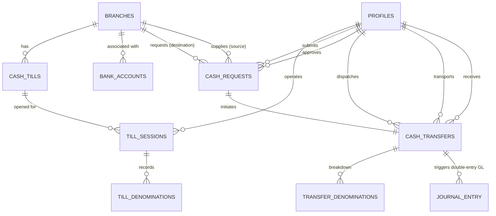
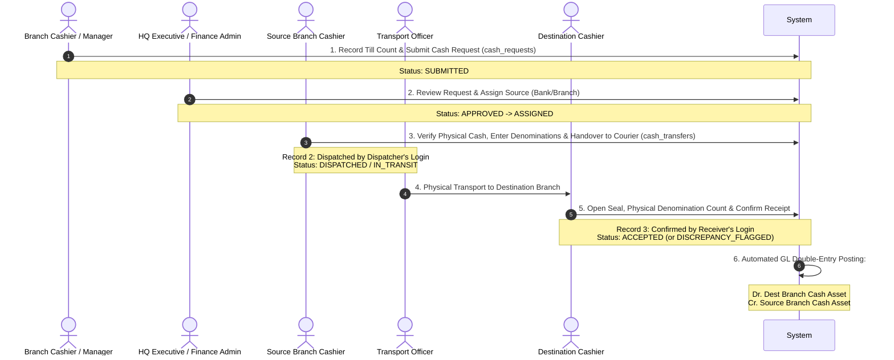
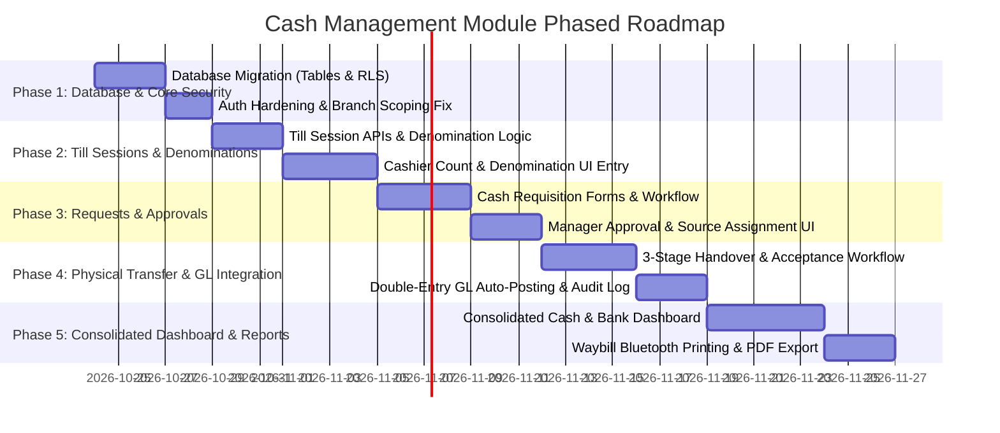

# Technical Audit: Cash Management Module for goldloan.app (Mifos Pawning Hub)

**Date of Investigation:** October 23, 2026  
**Auditor:** Antigravity AI Senior Systems & Financial Architecture Auditor  
**Repository Working Directory:** `c:\Users\janan\Downloads\Mifos-main\Mifos-main`  
**Target Environment:** Rupasinghe Pawning Hub - MIFOS System (`goldloan.app` / `mifos-finance.vercel.app`)  
**Scope:** Investigation and Architectural Blueprint for Consolidated Cash & Bank Management, Branch Cash Requirements, Approvals, Tills, Physical Dispatches, Receipts, and Transfers.

---

## 1. Executive Summary

This investigation was conducted to determine how to safely design and integrate an enterprise Cash Management Module into the existing **goldloan.app** platform without disrupting running operations.

### Key Investigation Findings:
1. **Application Nature — Custom Next.js/Supabase Solution, NOT Apache Fineract:**  
   Despite the repository naming and credentials referencing "MIFOS System", this application **does not run Apache Fineract** (no Java/Spring backend, no MySQL Fineract schema, no Fineract REST client). Instead, it is a custom-built, full-stack **Next.js 16 (React 19) + Supabase (PostgreSQL 15+) + Upstash Redis** system designed specifically for Sri Lankan pawn brokering ("Rupasinghe Pawning Hub").
2. **Current Cash State — Branch-Level Daily Ledgers without Till or Bank Visibility:**  
   The system currently tracks cash only as an end-of-day scalar figure per branch inside `public.daily_ledgers` (`opening_balance`, `closing_balance`, `actual_cash_count`, `transfer_in`, `transfer_out`). It lacks cash till/drawer granularity, physical currency denomination breakdowns, bank account master data, and live bank integration feeds.
3. **Current Transfer State — Primitive & Unsafe:**  
   There is a skeleton table `public.vault_transfer` and an endpoint `/api/transfers`, but they are **completely orphaned from the user interface**. Meanwhile, the user-facing `/transactions` page inserts directly from the browser into `public.transaction` using client-side credentials without server validation, approval workflows, or physical dispatch/receipt tracking.
4. **Auth & Multi-Tenancy Architecture — High Security Risk:**  
   Authentication is backed by Supabase Auth with custom user roles (`ADMIN`, `MANAGER`, `AUDITOR`, `TELLER`). However, branch scoping currently trusts an `x-branch-id` HTTP request header originating from browser `localStorage`. For financial transactions of high value (inter-branch cash movements), this trust model must be replaced with strict server-side validation against `profiles.branch_id` and tamper-proof session tokens.
5. **Path Forward:**  
   A dedicated Cash Management subsystem must be introduced. To avoid duplicating accounting logic, it should bridge physical cash movements (Requests -> Approvals -> Handover/Dispatch -> Transit -> Receipt/Acceptance) directly with automated balanced double-entry General Ledger postings in `public.journal_entry` and `public.journal_entry_line`.

---

## 2. Verified Technology Stack and Architecture

| Component | Verified Technology & Version | Repository Evidence |
|---|---|---|
| **Frontend Framework** | Next.js 16.2.2 / 16.2.10 (App Router), React 19.2.4 | [`frontend/package.json`](file:///c:/Users/janan/Downloads/Mifos-main/Mifos-main/frontend/package.json#L23-L28) |
| **Styling & Design System** | TailwindCSS v4, shadcn/ui, Radix/Base-UI, Lucide-React, Framer Motion, sonner | [`frontend/package.json`](file:///c:/Users/janan/Downloads/Mifos-main/Mifos-main/frontend/package.json#L12-L35) |
| **Backend / API Layer** | Next.js App Router Route Handlers (`src/app/api/**/route.ts`) | [`frontend/src/app/api`](file:///c:/Users/janan/Downloads/Mifos-main/Mifos-main/frontend/src/app/api) |
| **Primary Database** | PostgreSQL via Supabase Cloud (`ielkaetihagxgnrrasch.supabase.co`) | [`frontend/src/lib/supabase.ts`](file:///c:/Users/janan/Downloads/Mifos-main/Mifos-main/frontend/src/lib/supabase.ts#L3-L6) |
| **Database Migrations** | Raw SQL migration scripts (`supabase_schema.sql`, `supabase_migration_001.sql` to `005.sql`) | Repository Root |
| **Caching Layer** | Upstash Redis (`@upstash/redis` v1.39.0) with local memory fallback | [`frontend/src/lib/redis.ts`](file:///c:/Users/janan/Downloads/Mifos-main/Mifos-main/frontend/src/lib/redis.ts) |
| **Authentication** | Supabase Auth (JWT bearer tokens, cookies `sb-access-token`, `auth_token`) | [`frontend/src/lib/auth-server.ts`](file:///c:/Users/janan/Downloads/Mifos-main/Mifos-main/frontend/src/lib/auth-server.ts#L25-L64) |
| **Hardware Integrations** | Web Bluetooth API (TSPL receipt/label printer, ESC/POS bill printing) | [`frontend/src/lib/bluetooth`](file:///c:/Users/janan/Downloads/Mifos-main/Mifos-main/frontend/src/lib/bluetooth) |
| **Surveillance Integration**| On-premise CCTV daemon (`cctv-agent/agent.js`, RTSP/ONVIF cameras) | [`cctv-agent/agent.js`](file:///c:/Users/janan/Downloads/Mifos-main/Mifos-main/cctv-agent/agent.js) |
| **Real-Time Push** | **None.** No WebSockets, SSE, or Supabase Realtime channel listeners exist. All UI relies on standard fetch and manual/interval reloads. | Verified via codebase grep |

---

## 3. Existing Mifos/Fineract Capabilities and Customizations

* **Apache Fineract:** **Not present.** Searching for `fineract` yields 0 matches in the entire repository. There are no Spring Boot services, no Gradle builds, and no Fineract API clients.
* **Mifos Branding & Domain:** The application uses "Mifos" strictly as brand naming for this proprietary pawn finance platform (`Rupasinghe Pawning Hub - MIFOS System`).
* **Core Implemented Domains:**
  1. **Customer KYC / CRM:** [`frontend/src/app/clients/page.tsx`](file:///c:/Users/janan/Downloads/Mifos-main/Mifos-main/frontend/src/app/clients/page.tsx) (`public.clients`, `public.stock_customers`).
  2. **Pawn Origination, Appraisal & Gold Weighing:** [`frontend/src/app/loans/page.tsx`](file:///c:/Users/janan/Downloads/Mifos-main/Mifos-main/frontend/src/app/loans/page.tsx), [`frontend/src/lib/loanAgreementPrint.ts`](file:///c:/Users/janan/Downloads/Mifos-main/Mifos-main/frontend/src/lib/loanAgreementPrint.ts) (`public.pawns`, `public.pawn_items`).
  3. **Multi-Stage Approval Workflow:** [`frontend/src/app/operations/approvals/page.tsx`](file:///c:/Users/janan/Downloads/Mifos-main/Mifos-main/frontend/src/app/operations/approvals/page.tsx) (Auditor Recheck -> Manager Final Approval -> Cashier Disbursement).
  4. **Pawn Redemption & Settlement:** [`frontend/src/app/api/pawns/[id]/redeem/route.ts`](file:///c:/Users/janan/Downloads/Mifos-main/Mifos-main/frontend/src/app/api/pawns/%5Bid%5D/redeem/route.ts) with tiered interest calculations.
  5. **Branch Daily Ledger Matrix:** [`frontend/src/app/accounting/ledger/page.tsx`](file:///c:/Users/janan/Downloads/Mifos-main/Mifos-main/frontend/src/app/accounting/ledger/page.tsx) (`public.daily_ledgers`, `public.daily_ledger_transactions`, `public.daily_ledger_expenses`).
  6. **Double-Entry General Ledger (GL):** [`frontend/src/app/api/ledger/route.ts`](file:///c:/Users/janan/Downloads/Mifos-main/Mifos-main/frontend/src/app/api/ledger/route.ts) (`public.journal_entry`, `public.journal_entry_line`).
  7. **CCTV Audit & Video Recording:** [`frontend/src/app/cctv`](file:///c:/Users/janan/Downloads/Mifos-main/Mifos-main/frontend/src/app/cctv) (`public.cctv_cameras`, `public.cctv_recordings`, `public.cctv_audit_logs`).

---

## 4. Requirements Coverage Matrix

| Requirement | Audit Status | Codebase Evidence & Reality |
|---|---|---|
| **A. Consolidated cash & bank dashboard** | **Partially Existing** | Branch cash positions exist only as end-of-day balances in `daily_ledgers`. Bank accounts, bank balances, and bank feed synchronizations are **Missing**. `public.account` exists in SQL schema but is unused. |
| **B. Till count & denomination entry** | **Partially Existing** | `daily_ledgers.actual_cash_count` accepts a single scalar number. Denomination breakdown (notes/coins), cashier till assignment, and expected-vs-actual variance tracking by till are **Missing**. |
| **C. Cash requirement requests** | **Missing** | No cash requisition tables, UI forms, or endpoints exist. |
| **D. Approval & branch-to-branch assignment** | **Partially Existing** | Generic maker-checker pattern exists for pawn loans in `operations/approvals`, but **zero approval or assignment workflow exists for cash transfers**. |
| **E. Physical cash transfer tracking (9-stage lifecycle)** | **Missing** | `vault_transfer` only records `from_vault`, `to_vault`, `amount`, and `status`. No fields exist for dispatch person, transport/escort person, transit timestamps, departure, receipt confirmation, or discrepancy tracking. |
| **F. Three separate transactions & individual logins** | **Missing** | Current `/transactions` page inserts a single record directly via client-side Supabase. No three-stage attributable transaction chain exists. |

---

## 5. Relevant Database Tables and Relationships

### Existing Tables Analyzed
1. **`public.branches`** ([`supabase_schema.sql:1-7`](file:///c:/Users/janan/Downloads/Mifos-main/Mifos-main/supabase_schema.sql#L1-L7))  
   * Columns: `id text primary key` (e.g. `HQ`, `KHT`, `BRL`, `KDW`), `name text not null`, `is_active boolean`.  
   * Canonical branch mapping is maintained in code: [`CANONICAL_BRANCHES` in `frontend/src/lib/branch-mapping.ts`](file:///c:/Users/janan/Downloads/Mifos-main/Mifos-main/frontend/src/lib/branch-mapping.ts#L2-L18).
2. **`public.profiles`** ([`supabase_schema.sql:9-17`](file:///c:/Users/janan/Downloads/Mifos-main/Mifos-main/supabase_schema.sql#L9-L17), [`migration_003:50-56`](file:///c:/Users/janan/Downloads/Mifos-main/Mifos-main/supabase_migration_003.sql#L50-L56))  
   * Columns: `id uuid primary key references auth.users(id)`, `email text`, `branch_id text`, `branch_name text`, `role text default 'TELLER'`, `first_name text`, `last_name text`, `phone text`.
3. **`public.daily_ledgers`** ([`supabase_schema.sql:228-252`](file:///c:/Users/janan/Downloads/Mifos-main/Mifos-main/supabase_schema.sql#L228-L252))  
   * Unique constraint: `unique_branch_ledger_date (branch_id, ledger_date)`.  
   * Contains: `opening_balance`, `closing_balance`, `transfer_in`, `transfer_out`, `loan_issued_total`, `redemption_total`, `actual_cash_count`, `variance`, `status`.
4. **`public.journal_entry` & `public.journal_entry_line`** ([`supabase_schema.sql:76-95`](file:///c:/Users/janan/Downloads/Mifos-main/Mifos-main/supabase_schema.sql#L76-L95))  
   * Double-entry bookkeeping ledger. Validated in `/api/ledger/route.ts` where $\sum \text{Debit} = \sum \text{Credit}$.  
   * Limitation: `journal_entry_line` does not have a `branch_id` column; all postings aggregate into generic accounts (e.g., `'Vault Cash (Asset)'`).
5. **`public.vault_transfer`** ([`supabase_schema.sql:61-74`](file:///c:/Users/janan/Downloads/Mifos-main/Mifos-main/supabase_schema.sql#L61-L74))  
   * Columns: `id text primary key`, `date date`, `time text`, `from_vault text`, `to_vault text`, `amount numeric(12,2)`, `status text`, `initiated_by text`, `approved_by text`, `notes text`.  
   * Status: **Orphaned.** Not connected to any active UI page.
6. **`public.transaction`** ([`supabase_migration_003:8-17`](file:///c:/Users/janan/Downloads/Mifos-main/Mifos-main/supabase_migration_003.sql#L8-L17))  
   * Columns: `id uuid`, `client_id text`, `type text`, `branch_id text`, `target_branch_id text`, `amount numeric(12,2)`, `description text`, `timestamp timestamptz`.  
   * Currently misused as a flat, unvalidated transfer log in `/transactions/page.tsx`.
7. **`public.audit_logs`** ([`supabase_migration_002:18-28`](file:///c:/Users/janan/Downloads/Mifos-main/Mifos-main/supabase_migration_002.sql#L18-L28))  
   * System-wide audit log written via [`recordAuditLog()`](file:///c:/Users/janan/Downloads/Mifos-main/Mifos-main/frontend/src/lib/audit-logger.ts#L18-L56). Captures `user_id`, `user_email`, `role`, `branch_id`, `action`, `resource`, `details jsonb`, `created_at`.

---

## 6. Relevant API Endpoints and Services

| Route | Method | Purpose & Reality | Security & Audit | Reusability Recommendation |
|---|---|---|---|---|
| `/api/ledger/daily` | `GET`, `POST`, `PATCH`, `DELETE` | Retrieves and upserts branch daily ledger math. | Enforces `getAuthenticatedUser()`. Computes variance between entered cash and formula cash. | **Keep untouched.** Provides branch-level daily cash aggregation. |
| `/api/ledger` | `GET`, `POST` | Double-entry journal posting. | Server validates $\sum Debit = \sum Credit$. Records `created_by`. | **Reuse.** Must be called automatically upon cash transfer acceptance. |
| `/api/transfers` | `GET`, `POST`, `PATCH` | Basic CRUD on `vault_transfer`. Automatically posts GL entry on `Completed`. | Weak auth; does not record physical chain of custody; unused by UI. | **Replace/Refactor.** Superceded by the new Cash Management API. |
| `/api/vault` | `GET` | Aggregates `vault_transfer` records. | Unused by UI. | **Deprecate or replace.** |
| `/api/reports/financials` | `GET` | Generates Trial Balance and Profit & Loss. | Pulls directly from `journal_entry_line` and `pawns`. | **Extend.** Update to reflect bank and cash till accounts. |
| `/api/branches` | `GET`, `POST` | Branch master data. | Admin-only creation. | **Reuse.** Master list of locations. |
| `/api/staff` | `GET`, `POST` | Staff user directory & account creation. | Admin/Manager only. | **Reuse.** Source of employees and cashiers. |

---

## 7. Authentication, Roles, Permissions, and Audit Capabilities

### Current Auth Architecture
* **Tokens:** Supabase Auth JWT issued at `/api/auth/login`. Stored in browser `localStorage` (`auth_token`, `user`) and duplicate cookies (`sb-access-token`, `auth_token`).
* **Roles:** `ADMIN`, `MANAGER`, `AUDITOR`, `TELLER` ([`frontend/src/lib/auth-server.ts:13`](file:///c:/Users/janan/Downloads/Mifos-main/Mifos-main/frontend/src/lib/auth-server.ts#L13)).
* **Hardcoded Overrides:** [`frontend/src/app/api/auth/login/route.ts:64`](file:///c:/Users/janan/Downloads/Mifos-main/Mifos-main/frontend/src/app/api/auth/login/route.ts#L64) contains hardcoded email strings granted automatic `ADMIN` status (`erandiperera25@gmail.com`, `madushaniperera9617@gmail.com`, `tharushisandumini1111@gmail.com`).

### Security Vulnerabilities Discovered
1. **Branch Spoofing via `x-branch-id` Header:**  
   In [`frontend/src/lib/auth-server.ts:74-81`](file:///c:/Users/janan/Downloads/Mifos-main/Mifos-main/frontend/src/lib/auth-server.ts#L74-L81), the server overrides the user's authentic database branch with whatever is sent in the `x-branch-id` header:
   ```typescript
   const selectedBranch = request.headers.get('x-branch-id');
   if (selectedBranch && selectedBranch.trim() !== '') {
     branchId = normalizeBranchId(selectedBranch.trim());
   }
   ```
   *Impact:* Any teller can send an HTTP request claiming to be at another branch (e.g., claiming to be `KDW` while assigned to `BRL`), allowing unauthorized cash requests or fraudulent receipts.
2. **Direct Client-Side Database Inserts:**  
   In [`frontend/src/app/transactions/page.tsx:93-100`](file:///c:/Users/janan/Downloads/Mifos-main/Mifos-main/frontend/src/app/transactions/page.tsx#L93-L100), transfers are inserted directly into `public.transaction` using the client-side Supabase anon client with unverified values from `localStorage`.
3. **Audit Log Non-Repudiation:**  
   [`public.audit_logs`](file:///c:/Users/janan/Downloads/Mifos-main/Mifos-main/frontend/src/lib/audit-logger.ts) is functional, but lacks cryptographic hashing or record locking.

---

## 8. Current Cash and Bank Balance Sources

| Balance Type | Current Authoritative Source | How It Is Obtained Currently | Requirements for Cash Management Module |
|---|---|---|---|
| **Bank Account Balances** | **None.** Does not exist in the system. | Not available. | Needs a new `bank_accounts` master table and manual statement entry or bank CSV/API sync. |
| **Branch Cash Positions** | `public.daily_ledgers.closing_balance` | Computed daily from pawn loans, redemptions, and expenses on the daily matrix. | Authoritative for historical days; live position must be computed dynamically from today's till balances. |
| **Cash on Hand / Till Balances** | **None.** No till entity exists. | Currently conflated with the branch closing cash. | Needs dedicated `cash_tills` and `till_sessions` tracking live cash drawers per cashier. |
| **Cash in Transit** | **None.** | Not tracked. | Needs tracking from `cash_transfers` where status is `DISPATCHED` or `IN_TRANSIT`. |
| **Physical Denomination Counts**| **None.** | Cashiers enter only a single total number. | Needs denomination breakdown table (Rs. 5000, 1000, 500, 100, 50, 20, 10, coins). |

---

## 9. Proposed Conceptual Data Model

To support all requirements without breaking existing daily ledger or loan modules, the following relational data model is proposed:



### 1. `bank_accounts` (Master Bank Directory)
* `id` (UUID, PK)
* `bank_name` (Text, e.g. "Commercial Bank of Ceylon", "Bank of Ceylon", "Sampath Bank")
* `account_number` (Text, unique)
* `account_name` (Text)
* `branch_id` (Text, FK -> `branches.id`, nullable for corporate HQ accounts)
* `gl_account_name` (Text, default 'Bank Asset')
* `current_balance` (Numeric 14,2)
* `is_active` (Boolean, default true)
* `created_at`, `updated_at` (Timestamptz)

### 2. `cash_tills` (Location Cash Drawers)
* `id` (UUID, PK)
* `branch_id` (Text, FK -> `branches.id`)
* `till_name` (Text, e.g. "Counter 01 Till", "Manager Vault Drawer")
* `assigned_role` (Text, e.g. 'TELLER', 'MANAGER')
* `is_active` (Boolean)
* `created_at` (Timestamptz)

### 3. `till_sessions` (Cashier Shifts & Count Submissions)
* `id` (UUID, PK)
* `till_id` (UUID, FK -> `cash_tills.id`)
* `user_id` (UUID, FK -> `auth.users.id`)
* `branch_id` (Text, FK -> `branches.id`)
* `opened_at` (Timestamptz)
* `closed_at` (Timestamptz, nullable)
* `opening_cash` (Numeric 12,2)
* `system_expected_cash` (Numeric 12,2)
* `actual_counted_cash` (Numeric 12,2)
* `variance_amount` (Numeric 12,2)
* `status` (Text: `'OPEN'`, `'CLOSED'`, `'FLAGGED'`)
* `verified_by_manager_id` (UUID, nullable)
* `notes` (Text)

### 4. `till_denominations` (Physical Currency Counts)
* `id` (UUID, PK)
* `session_id` (UUID, FK -> `till_sessions.id`)
* `count_type` (Text: `'OPENING'`, `'CLOSING'`, `'AUDIT_SPOT_CHECK'`)
* `notes_5000` (Integer default 0)
* `notes_1000` (Integer default 0)
* `notes_500`  (Integer default 0)
* `notes_100`  (Integer default 0)
* `notes_50`   (Integer default 0)
* `notes_20`   (Integer default 0)
* `coins_total`(Numeric 10,2 default 0.00)
* `total_value`(Numeric 12,2 generated or computed)
* `counted_at` (Timestamptz)

### 5. `cash_requests` (Attributable Record 1: Requisitions)
* `id` (UUID, PK)
* `request_ref` (Text, unique, e.g. `REQ-20261023-001`)
* `requesting_branch_id` (Text, FK -> `branches.id`)
* `requested_by_user_id` (UUID, FK -> `auth.users.id`)
* `requested_amount` (Numeric 12,2)
* `current_branch_cash` (Numeric 12,2 snapshot)
* `required_date` (Date)
* `purpose` (Text: `'PAWN_DISBURSEMENTS'`, `'VAULT_REPLENISHMENT'`, `'EMERGENCY'`)
* `status` (Text: `'SUBMITTED'`, `'APPROVED'`, `'REJECTED'`, `'RETURNED'`, `'FULFILLED'`, `'CANCELLED'`)
* `approved_by_user_id` (UUID, nullable)
* `approved_amount` (Numeric 12,2, nullable)
* `approval_timestamp` (Timestamptz, nullable)
* `source_type` (Text: `'BRANCH'`, `'BANK'`)
* `source_branch_id` (Text, nullable)
* `source_bank_account_id` (UUID, nullable)
* `created_at`, `updated_at` (Timestamptz)

### 6. `cash_transfers` (Attributable Record 2 & 3: Movement & Handover)
* `id` (UUID, PK)
* `transfer_ref` (Text, unique, e.g. `TRF-20261023-001`)
* `request_id` (UUID, FK -> `cash_requests.id`, nullable for unscheduled balancing)
* `source_branch_id` (Text, FK -> `branches.id`)
* `dest_branch_id` (Text, FK -> `branches.id`)
* `dispatched_amount` (Numeric 12,2)
* `received_amount` (Numeric 12,2, nullable)
* `discrepancy_amount` (Numeric 12,2 default 0.00)
* `status` (Text: `'ASSIGNED'`, `'DISPATCHED'`, `'IN_TRANSIT'`, `'DELIVERED'`, `'ACCEPTED'`, `'DISCREPANCY_FLAGGED'`, `'CANCELLED'`)
* **Dispatch Handover (Record 2):**
  * `dispatched_by_user_id` (UUID, FK -> `auth.users.id`)
  * `transport_carrier_type` (Text: `'INTERNAL_OFFICER'`, `'SECURITY_COURIER'`)
  * `transport_person_name` (Text)
  * `transport_person_nic` (Text)
  * `dispatch_timestamp` (Timestamptz)
  * `dispatch_notes` (Text)
  * `security_bag_seal_number` (Text)
* **Receipt & Acceptance (Record 3):**
  * `received_by_user_id` (UUID, FK -> `auth.users.id`, nullable)
  * `receipt_timestamp` (Timestamptz, nullable)
  * `discrepancy_notes` (Text, nullable)
* `gl_journal_entry_id` (Text, nullable FK -> `journal_entry.id`)
* `created_at`, `updated_at` (Timestamptz)

### 7. `cash_transfer_denominations` (Dispatch/Receipt Breakdown)
* `id` (UUID, PK)
* `transfer_id` (UUID, FK -> `cash_transfers.id`)
* `stage` (Text: `'DISPATCH'`, `'RECEIPT'`)
* `notes_5000` through `notes_20` (Integers)
* `coins_total` (Numeric 10,2)
* `total_amount` (Numeric 12,2)

---

## 10. Proposed Cash Management Workflow and State Transitions



### Prevention of Self-Approval & Non-Repudiation Rules:
1. `cash_requests.requested_by_user_id !== cash_requests.approved_by_user_id`: An employee cannot approve their own requisition.
2. `cash_transfers.dispatched_by_user_id !== cash_transfers.received_by_user_id`: The person dispatching cannot be the person accepting the cash at destination.
3. Every step requires verification of the active Supabase JWT session server-side; client-supplied user IDs or role fields are discarded.
4. If `dispatched_amount !== received_amount`, the status automatically enters `DISCREPANCY_FLAGGED`, preventing automatic GL closure until HQ Manager investigation and counter-signing.

---

## 11. Frontend Integration Plan

### Navigation Placement in [`DashboardSidebar.tsx`](file:///c:/Users/janan/Downloads/Mifos-main/Mifos-main/frontend/src/components/DashboardSidebar.tsx)
The new module should be added under the **"Finance"** or a dedicated **"Cash & Banking"** navigation group:
* **Admin / Manager Menu:**
  * `Cash Dashboard` (`/finance/cash`)
  * `Cash Requisitions` (`/finance/cash/requests`)
  * `Cash Transfers & Transit` (`/finance/cash/transfers`)
  * `Bank Accounts` (`/finance/cash/banks`)
  * `Till Sessions & Denominations` (`/finance/cash/tills`)
* **Teller Menu:**
  * `My Till Count` (`/finance/cash/tills/count`)
  * `Request Cash` (`/finance/cash/requests/new`)
  * `Receive Incoming Cash` (`/finance/cash/transfers/receive`)

### Reusable UI Conventions
* Cards and Glassmorphism design tokens: [`TopGlassNavbar.tsx`](file:///c:/Users/janan/Downloads/Mifos-main/Mifos-main/frontend/src/components/TopGlassNavbar.tsx), [`components/ui/card.tsx`](file:///c:/Users/janan/Downloads/Mifos-main/Mifos-main/frontend/src/components/ui/card.tsx).
* Modal Dialogs: [`CustomerSelectionModal.tsx`](file:///c:/Users/janan/Downloads/Mifos-main/Mifos-main/frontend/src/components/CustomerSelectionModal.tsx), [`PacketQrScannerModal.tsx`](file:///c:/Users/janan/Downloads/Mifos-main/Mifos-main/frontend/src/components/PacketQrScannerModal.tsx).
* Tables with search and branch filtering: [`accounting/ledger/page.tsx`](file:///c:/Users/janan/Downloads/Mifos-main/Mifos-main/frontend/src/app/accounting/ledger/page.tsx).
* Toast alerts: `sonner` (`toast.success()`, `toast.error()`).

---

## 12. Required New Features and Changes to Existing Components

### New Endpoints to Create:
1. `GET /api/cash/dashboard`: Returns consolidated cash balances across all branches, active tills, bank balances, and cash currently in transit.
2. `GET / POST /api/cash/tills/session`: Starts/closes till session, captures opening/closing denomination breakdowns, and calculates expected vs. actual variance.
3. `GET / POST /api/cash/requests`: Requisition submission and query.
4. `PATCH /api/cash/requests/[id]/approve`: Approver decision, approval amount, source assignment.
5. `POST /api/cash/transfers/dispatch`: Dispatches cash, records escort/transport person details, seal number, and locks out the sender.
6. `POST /api/cash/transfers/receive`: Receiver confirms physical receipt and denomination breakdown; triggers automatic balanced GL posting.
7. `GET / POST /api/cash/banks`: Bank account master data and manual balance adjustments.

### Modifications to Existing Code:
1. **`frontend/src/lib/auth-server.ts`**:
   * Add a strict verification function `validateOperatingBranch(session, requestedBranchId)` that prevents tellers from spoofing branch IDs via `x-branch-id` headers.
2. **`frontend/src/components/DashboardSidebar.tsx`**:
   * Add navigation items for Cash Management tailored to `ADMIN`, `MANAGER`, and `TELLER`.
3. **`frontend/src/app/transactions/page.tsx`**:
   * Replace unsafe client-side `supabase.from('transaction').insert()` with a redirect or link to the new authenticated Cash Transfer workflow.

---

## 13. Security, Accounting, and Operational Risks

| Risk Area | Severity | Impact | Recommended Safeguard |
|---|---|---|---|
| **Branch Impersonation (`x-branch-id`)** | **CRITICAL** | A teller can dispatch or receive cash on behalf of another branch by modifying headers. | Server must validate that `session.profile.branch_id === targetBranchId` for tellers; disregard client-provided header overrides for financial actions. |
| **Self-Approval** | **HIGH** | Requesters approving their own cash requisitions. | Server-side enforcement: `cash_requests.requested_by_user_id !== session.user.id` on approval routes. |
| **Silent Discrepancy Concealment** | **HIGH** | A receiver claiming Rs. 500,000 was sent but only Rs. 400,000 was received without immediate audit alert. | Automated status switch to `DISCREPANCY_FLAGGED`, instant SMS notification to HQ Auditor, and lock on the transfer record. |
| **Unbalanced General Ledger** | **HIGH** | Creating cash transfers without corresponding credit and debit entries in `journal_entry_line`. | Enforce single-transaction double-entry posting: Debit `Dest Branch Cash`, Credit `Source Branch Cash` in an atomic PostgreSQL transaction. |
| **Concurrency / Duplicate Transfers** | **MEDIUM** | Double-clicking "Dispatch" or "Approve" causing duplicate allocations. | Unique idempotency reference keys (`request_ref`, `transfer_ref`) and database row-level locking (`SELECT ... FOR UPDATE`). |
| **Offline Transport Handover** | **MEDIUM** | Mobile network drops when cash courier arrives at remote branch. | Implement printable Physical Handover Waybill with QR Code containing digital signature payload. |

---

## 14. Dependencies, Blockers, and Unanswered Business Questions

1. **Bank Feeds & External Integrations:**  
   * *Status:* **No bank APIs currently exist** in the repository. Sri Lankan banks (Commercial Bank, BOC, Sampath) typically require proprietary host-to-host (H2H) SFTP integrations or corporate Open Banking APIs.
   * *Recommendation:* Phase 1 must implement manual bank account ledger tracking (recording deposits, withdrawals, and bank balance reconciliations). Phase 2 can introduce CSV/MT940 bank statement imports.
2. **Till Ownership Model:**  
   * *Question:* Does a branch have one communal vault till, or does each individual cashier operate an independent physical cash drawer?
   * *System Capability:* The proposed schema supports both, but requires client confirmation.
3. **Escort / Carrier Security Protocols:**  
   * *Question:* Is cash transported by company employees (e.g. branch managers with motorbikes) or third-party armored couriers (e.g. Certis Lanka, Brink's)?
   * *Design:* The schema includes fields for carrier type, courier agent name, NIC, and tamper-evident bag seal numbers.

---

## 15. Recommended Phased Implementation Plan



* **Phase 1: Database & Foundation**  
  Deploy SQL migration for `bank_accounts`, `cash_tills`, `till_sessions`, `till_denominations`, `cash_requests`, and `cash_transfers`. Harden server-side auth against branch spoofing.
* **Phase 2: Till Management & Denominations**  
  Implement cashier till opening/closing, denomination breakdown tables, and variance tracking against pawn disbursement/redemption totals.
* **Phase 3: Cash Requisitions & Approval Queue**  
  Implement employee cash requests and HQ maker-checker approvals with source assignment.
* **Phase 4: Physical Transfer Lifecycle (3 Attributable Records)**  
  Implement the full dispatch -> transit -> acceptance sequence with individual employee logins and automatic double-entry GL journal posting.
* **Phase 5: Executive Consolidated Dashboard**  
  Build the real-time cash position dashboard displaying bank balances, branch vault totals, active tills, in-transit funds, and printable waybills.

---

## 16. Test Strategy and Acceptance Criteria

1. **Authentication & Identity Test:**
   * A user logged in as `TELLER` at `KHT` attempts to dispatch cash from `BRL`. The server **must return HTTP 403 Forbidden**.
2. **Requisition Self-Approval Test:**
   * A Manager requests cash for branch `KTW` and attempts to approve their own request. The system **must block the action**.
3. **Three Distinct Attributable Logins Test:**
   * Verify in database records that:
     * `cash_requests.requested_by_user_id` matches User A.
     * `cash_transfers.dispatched_by_user_id` matches User B.
     * `cash_transfers.received_by_user_id` matches User C.
4. **Denomination Sum Integrity Test:**
   * Enter note counts (e.g. $10 \times 5000 + 5 \times 1000 = 55,000$). Verify calculated total matches entered amount exactly to 2 decimal places.
5. **Double-Entry General Ledger Balance Test:**
   * Upon receipt acceptance of Rs. 250,000 transferred from `HQ` to `KDW`, verify `public.journal_entry` and `public.journal_entry_line` reflect:
     * Debit: `Vault Cash (KDW Asset)` = Rs. 250,000.00
     * Credit: `Vault Cash (HQ Asset)` = Rs. 250,000.00
     * $\text{Total Debit} - \text{Total Credit} = 0.00$.

---

## 17. Exact Files and Code Locations for Implementation

### Files to Create:
1. `supabase_migration_006_cash_management.sql`: Schema definitions, indexes, and RLS policies.
2. `frontend/src/app/api/cash/dashboard/route.ts`: Consolidated cash metrics API.
3. `frontend/src/app/api/cash/requests/route.ts`: Requisition lifecycle API.
4. `frontend/src/app/api/cash/transfers/route.ts`: Dispatch, transit, and receipt handover API.
5. `frontend/src/app/api/cash/tills/route.ts`: Till session & denomination count API.
6. `frontend/src/app/finance/cash/page.tsx`: Consolidated Cash & Bank Dashboard UI.
7. `frontend/src/app/finance/cash/requests/page.tsx`: Cash request submission and approval queue.
8. `frontend/src/app/finance/cash/transfers/page.tsx`: Physical transfer tracker & receipt acceptance interface.
9. `frontend/src/app/finance/cash/tills/page.tsx`: Physical denomination counter component.

### Files to Modify:
1. [`frontend/src/lib/auth-server.ts`](file:///c:/Users/janan/Downloads/Mifos-main/Mifos-main/frontend/src/lib/auth-server.ts): Add strict branch session verification to prevent header spoofing.
2. [`frontend/src/components/DashboardSidebar.tsx`](file:///c:/Users/janan/Downloads/Mifos-main/Mifos-main/frontend/src/components/DashboardSidebar.tsx): Add Cash Management navigation items.
3. [`frontend/src/app/transactions/page.tsx`](file:///c:/Users/janan/Downloads/Mifos-main/Mifos-main/frontend/src/app/transactions/page.tsx): Replace unsafe direct-insert form with links to the verified Cash Transfer workflow.
4. [`frontend/src/app/accounting/reports/page.tsx`](file:///c:/Users/janan/Downloads/Mifos-main/Mifos-main/frontend/src/app/accounting/reports/page.tsx): Add bank accounts and till balances into the trial balance view.
